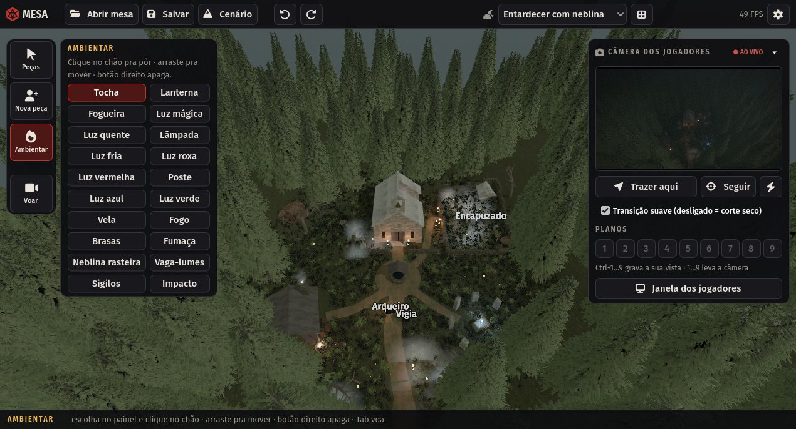
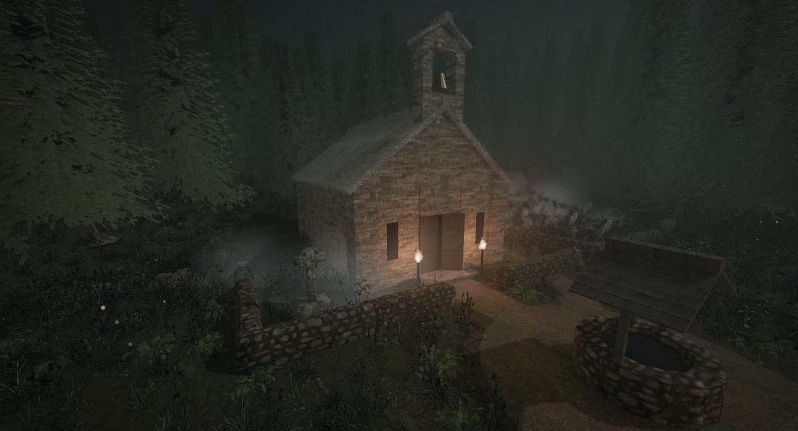
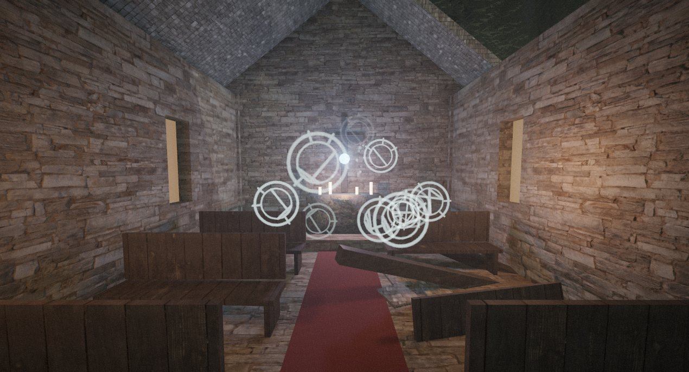
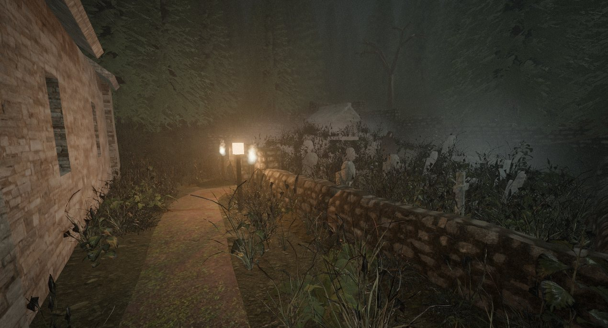

<div align="center">

# 🎲 Mesa 3D

**Mesa de RPG em 3D para o mestre narrar com cara de cinema.**<br>
Você controla tudo numa tela; os jogadores assistem a outra, que só mostra o que a câmera deles vê.

Feita em [Godot 4](https://godotengine.org) · cenários gerados por código no [Blender](https://www.blender.org)



</div>

## O que ela faz

|  |  |
|---|---|
| 🎥 **Duas janelas** | A tela do mestre tem painéis, grade e nomes. A janela dos jogadores só tem a imagem e pode ir pro segundo monitor, pro OBS ou pro Discord (**F11** = tela cheia). |
| 🎬 **Câmera dos jogadores** | **C** leva a câmera pra onde você está olhando, com transição suave ou corte seco. Grave até 9 planos (**Ctrl+1…9**) e chame com **1…9**. Ela também segue uma peça e treme (susto, explosão). |
| 🧙 **Seus personagens** | Botão **Adicionar personagem…** (ou arraste as imagens pra janela): cada imagem vira uma variação, e uma com "costas" no nome vira as costas. |
| ♟️ **Peças** | Arraste pra mover. Segure o botão direito e solte pra mandar andar (a linha mostra os metros). Arraste no vazio pra pegar várias. |
| 🔥 **Ambientar** | Clique no chão pra pôr tocha, fogueira, lanterna, luz mágica, vela, fumaça, brasas, vaga-lumes, neblina rasteira, sigilos girando… |
| 🌫️ **Climas** | Noite com neblina, floresta sombria, entardecer, dia nublado, noite na cidade. A câmera dos jogadores tem neblina volumétrica, profundidade de campo e granulação. |
| 🚪 **Portas** | Portas do cenário abrem e fecham com um clique. Também dá pra fazer passagem secreta: uma geladeira que desliza, por exemplo. |
| ↩️ **Desfazer** | **Ctrl+Z** / **Ctrl+Y** em tudo: criar, mover, apagar, mandar andar. |
| 💾 **Salvar mesa** | Peças, luzes, efeitos, clima e planos de câmera vão num `.json`. |
| ⚙️ **Qualidade** | Presets Baixo, Médio e Alto. Só o PC do mestre renderiza, então dá pra usar o Alto e os jogadores só assistem. |

<table>
<tr>
<td></td>
<td></td>
<td></td>
</tr>
<tr>
<td align="center"><sub>Capela na mata, entardecer com neblina</sub></td>
<td align="center"><sub>Dentro da capela, com sigilos</sub></td>
<td align="center"><sub>Caminho do cemitério</sub></td>
</tr>
</table>

## Como rodar

Precisa do **Godot 4.7** (Forward+).

```bash
git clone https://github.com/remynzo/mesa-3d.git
cd mesa-3d
godot --path . -- --mesa cenarios/capela_mesa.json
```

Aberta sem nada (`godot --path .`), ela carrega a capela de exemplo e mostra uma ajuda curta na primeira vez; o botão **?** traz a ajuda de volta. Para trocar de cenário, use o botão **Cenário** ou arraste um `.glb` pra janela.

## Controles

| Modo | O que faz |
|---|---|
| **Peças** | clique seleciona · Shift+clique soma · arraste a peça pra mover · botão direito: mandar andar · clique numa porta abre/fecha · **Q/E** gira · **B** troca a variação · **Delete** apaga |
| **Nova peça** | clique no chão põe a peça com o nome, o personagem e a cor do painel |
| **Ambientar** | escolha no painel e clique no chão · arraste pra mover · botão direito apaga |
| **Voar** (**Tab**) | **WASD** anda · **Espaço** sobe · **Shift** desce · segure **Ctrl** pra ir rápido · rodinha muda a velocidade |

Fora do modo Voar: rodinha = zoom · botão do meio gira em volta do ponto. **Esc** abre as configurações.

## Fazer seus próprios cenários

Um cenário é só um `.glb`. O começo do nome de cada objeto diz como a mesa trata ele:

| Nome | Como fica na mesa |
|---|---|
| `arq_…` / `obj_…` | tem colisão (as peças pisam e esbarram) |
| `lote_…` | miudezas repetidas, desenhadas em lote, sem colisão |
| `semcol_…` | teto, prédio vizinho: aparece, mas o clique passa direto |
| `obj_porta_a<graus>p<cm>d<cm>_…` | porta: um clique gira `<graus>` em volta do ponto `<p>` cm no eixo x do modelo e/ou desliza `<d>` cm; o clique seguinte volta |

`cenarios/capela.py` é um exemplo completo gerado por código:

```bash
blender -b -P cenarios/capela.py -- cenarios
```

> Os modelos baixados que ele usa (Poly Haven, CC0) não estão no repositório. O `capela.glb` pronto está.

Personagens adicionados pela tela ficam na pasta de dados do Godot (`user://personagens/`). Também dá pra pôr direto em `personagens/<nome>/` no projeto: uma imagem por variação (`arco.webp`, `capuz.webp`…), mais `costas.webp` para as costas. Sem personagem, a peça vira uma ficha simples.

A mesa salva (`.json`) guarda o cenário com caminho relativo quando ele está na mesma pasta: leve a pasta junto e ela abre em outro PC.

## Testes

```bash
godot --path . -- --foto teste/teste.glb                    # checagens automáticas + fotos em provas/
godot --path . -- --mesa cenarios/capela_mesa.json --fotos   # fotos de uma mesa pronta, FPS e teste das portas
godot --path . -- --carga --preset Baixo                     # 300 peças + 20 luzes: mede o FPS
```

## Estrutura

```
scripts/    código do programa (main.gd é a entrada; um arquivo por assunto)
cenarios/   cenários .glb e os scripts do Blender que geram eles
teste/      cenário de teste usado pelas checagens
fontes/     Fira Sans e ícones (licenças em fontes/LICENCAS.txt)
docs/       imagens deste README
```
